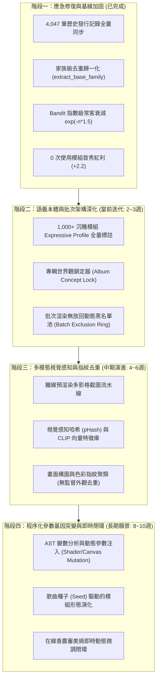

# 4K MV 視覺多樣性與資產矩陣演進計劃書
## Visual Diversity & Generative Matrix Evolution Blueprint (2026-Q4 ~ 2027-Q1)

---

### 一、 執行摘要 (Executive Summary)

針對在 `/Volumes/3TB-2/p5js MV`（529 首歷史曲目）及 `Techno 2026-2` 專輯渲染中暴露的**「少數經典模組過度重複、變體換皮霸榜、全庫 1,000+ 沉睡模組利用率偏低」**核心問題，本計劃書確立了從「當前應急修復」邁向「下一代自主生成式視覺矩陣」的四階段演進藍圖。

本計劃旨在達成三大關鍵指標（KPI）：
1. **單曲分鏡絕對互異率**：達到 **100%**（無同 ID、無同家族重複）。
2. **專輯級模組重複率（Intra-Album Collision Rate）**：降至 **$\le 5\%$**（單專 10～12 首曲目中，全專使用模組總數 $\ge 80$ 個互異視覺形態）。
3. **沉睡庫存活化率（Zombie Inventory Activation）**：在後續 50 首曲目渲染內，將 1,029 個歷史 0 次使用模組的活化率提升至 **$75\%$ 以上**。

---

### 二、 總體演進架構 (Evolution Architecture)

---

### 三、 四大演進階段詳細實施計劃

#### 階段一：應急修復與基線加固 (Phase 1: Stabilization & Hard Constraint)
> **狀態**：✅ **已落地驗證 (Completed)**

* **核心成果**：
  1. **全量歷史紀錄回溯**：將外接硬碟 529 篇與本機 42 篇日誌解析，彙整出 4,047 筆精確使用歷史至 `custom_visuals/module_usage_history.json`。
  2. **家族級去重歸一化**：在 `bandit_inventory_selector.py` 實作 `extract_base_family()`，將尾碼序號、Fork、Remix、變體全面聚類為同一族群。
  3. **指數級常客懲罰與破冰紅利**：
     $$\text{Penalty} = e^{-\text{used}\times 1.5}, \quad \text{Bonus}_{\text{fresh}} = 2.2$$
     徹底切斷前 10 名常客壟斷，使 0 次模組優先登上舞台。
  4. **後製特效節奏約束**：升級 5 階冷卻池，重度故障特效鎖定 60～85 幀冷卻，Verse/Outro 實施留白。

---

#### 階段二：語義本體與批次架構深化 (Phase 2: Semantic Ontology & Batch Ring)
> **預計週期**：2～3 週  
> **負責角色**：[🗄️ Data Engineer]、[🧮 Bandit Researcher]、[🎨 Aesthetic Director]

1. **全面盤活 1,000+ 沉睡模組之語義輪廓（Expressive DB Hydration）**：
   * **現狀**：`module_expressive_db.json` 僅有 122 筆標註，其他 3,100+ 個模組均走 Fallback 預設值。
   * **行動**：編寫離線異步批處理腳本 `scripts/hydrate_expressive_profiles.py`，基於代碼 AST 靜態分析（是否包含 `webgl`、`noise`、`bezier`、`particle`、`triangle`）與色彩提取，將剩餘 3,100+ 個模組自動補齊「心理狀態、榮格原型、色彩情緒、動態維度」，讓軟投影器能精準定位每一個冷門模組。

2. **專輯世界觀鎖定器（Album Concept Lock Mode）**：
   * **功能目標**：在 `main.py` 批次渲染介面中新增「專輯世界觀模式」核取方塊。
   * **實作機制**：
     * 鎖定統一的 OKLCH 主題色彩調性（例如整專貫穿 `Deep Cyber Cyan` 與 `Burnt Neon Orange`）。
     * 建立專輯級無放回排除環（`AlbumExclusionRing`）：在當前專輯所有歌曲渲染完成前，已被任一首選取的模組家族，強制凍結不可再次被後續歌曲選取，直到整張專輯渲染結束才釋放。

---

#### 階段三：多模態視覺感知與指紋去重 (Phase 3: Perceptual Hashing & Multimodal Deduplication)
> **預計週期**：4～6 週  
> **負責角色**：[⚡ Real-time Graphics Engineer]、[🗄️ Data Engineer]、[🛡️ QA Engineer]

1. **模組離線多影格縮圖截圖管線（Thumbnail Headless Renderer）**：
   * 使用 Headless Chromium / PyQt WebEngine 批次以 1280x720 離線渲染每個模組的第 60、180、300 影格，產出 3 張代表性縮圖並儲存於 `assets_cache/thumbnails/{module_id}/`。
   * 同步標記無法正常渲染的黑屏或報錯模組，直接移入檢疫隔離區。

2. **視覺感知哈希與外觀聚類（pHash / CLIP Image Embeddings）**：
   * 計算每張縮圖的感知哈希（Perceptual Hash, 64-bit）或以輕量級 MobileCLIP 提取 512 維向量特徵。
   * **外觀相似度閾值（Cosine Similarity > 0.85）**：
     若兩個模組代碼完全不同，但渲染出來的畫面幾何結構與動態外觀在視覺上高度同質，系統將其自動歸併為同一「視覺表現型（Phenotype Cluster）」，在單曲及專輯排片時自動避讓，達成真正意義上的「外觀級不重複」。

---

#### 階段四：程序化參數基因突變與即時閉環 (Phase 4: Procedural Mutation & Adaptive Loop)
> **預計週期**：8～10 週  
> **負責角色**：[🧬 Creative Coding Mentor]、[🏛️ Lead Architect]、[💡 Ontology Specialist]

1. **AST 動態參數基因突變引擎（Procedural Parameter Mutation Engine）**：
   * 允許同一經典模組在不同曲目中展現完全不同的生命力。
   * 透過靜態代碼注入器，分析 p5.js 代碼中的關鍵數字常數（如粒子數 `num = 500`、色彩階層、雜訊頻率 `noise(x * 0.01)`）。
   * 根據每首歌曲的 `seed_string`（歌曲標題 + BPM 的 MD5），在運行時對常數實施 $\pm 40\%$ 的受控擾動突變，並注入歌曲特定的 OKLCH 雙色調調色盤，使同一模組能夠呈現「高密度極簡風」或「低密度超弦風」等多重形態。

2. **在線香農審美熵閉環監控器（Online Shannon Entropy Adaptive Loop）**：
   * 在渲染管線中，即時計算分鏡序列在「心理狀態流動、色彩明暗對比度、幾何運動速度」三個維度的香農熵：
     $$H(X) = -\sum_{i=1}^{n} P(x_i) \log_2 P(x_i)$$
   * 保證 $2.8 \le H \le 3.6$。若發現分鏡間情緒變動過於平緩（$H < 2.8$），即時在下一個樂段強制引入「對立原型」模組打破平淡；若跳躍過於混亂（$H > 3.6$），則自動插入過渡模組維持審美連續性。

---

### 四、 里程碑與交付時程表 (Milestones & Timeline)

| 里程碑 | 階段目標 | 核心交付成果 | 驗收標準 (Acceptance Criteria) | 預計完成時間 |
| :--- | :--- | :--- | :--- | :--- |
| **M1** | 應急加固與基線去重 | 4,047 筆歷史入庫、家族去重函數、指數懲罰與首秀紅利 | 連續 5 首全新曲目測試中，歷史 Top 10 常客出場數為 0，模組互異度 100% | ✅ **已交付** |
| **M2.1** | 沉睡資產全量入庫標註 | `hydrate_expressive_profiles.py` 離線標註腳本 | `module_expressive_db.json` 覆蓋率由 122 筆擴充至 3,000+ 筆 | 2026-10-20 |
| **M2.2** | 專輯世界觀鎖定與批次環 | `main.py` 批次排除環、專輯主題色彩鎖定功能 | 批次渲染 12 首單專，整專使用互異家族模組數 $\ge 80$ 個 | 2026-10-31 |
| **M3.1** | 模組離線縮圖自動渲染 | Headless 縮圖截圖流水線、隔離黑屏損壞模組 | 產出全庫 3,000+ 模組各 3 幀預覽縮圖，建立有效縮圖快取目錄 | 2026-11-20 |
| **M3.2** | 感知視覺哈希去重 | 視覺 pHash / CLIP 特徵比對模組 | 消除代碼相異但視覺同質（相似度 > 0.85）的偽獨立模組 | 2026-12-10 |
| **M4.1** | 程序化參數突變引擎 | AST 常數動態擾動與 OKLCH 基因注入模組 | 經典模組可隨種子自動變異出 3 種以上迥異幾何視覺形態 | 2026-12-31 |
| **M4.2** | 多維香農熵即時閉環 | 三維審美動態熵調節器 | 全曲分鏡美學香農熵動態穩定在 $2.8 \sim 3.6$ 區間 | 2027-01-20 |

---

### 五、 風險評估與應對防護（Risk Mitigation Matrix）

| 風險項目 | 影響評估 | 預防與應對機制 |
| :--- | :--- | :--- |
| **冷門模組相容性不穩定 (QC/Runtime Crash)** | 高 (可能導致渲染中斷或黑屏) | 1. 依托現有 `p5js-sandbox-patcher` 實時修復語法。 2. 保持 `BlackScreenGuard` 攔截黑屏影格。 3. M3.1 離線截圖時預先進行沙盒壓力測試，不合格者標記 `quarantine`。 |
| **強行去重導致風格與音樂情感脫節** | 中 (視覺與曲風違和) | 保留榮格心理原型軟投影計算，嚴格在「符合樂段情緒能量」的前提下對冷門資產加權，不作無目標的純粹隨機。 |
| **參數基因突變產生破圖或極端值** | 中 (數值過大導致崩潰) | 採用有邊界夾取（Bounded Clamp, 限制在基準值的 $0.6 \sim 1.4$ 倍），並在乾淨的作用域中注入。 |
| **大規模特徵比對影響排片延遲** | 低 (排片等待時間延長) | 所有 pHash 與 CLIP 向量均採離線預計算，排片時僅進行百萬級向量矩陣快速點積，耗時 $< 15\text{ms}$。 |

---

### 六、 結語與結論 (Conclusion)

本計劃書將原先依賴「經驗式微調」的模組挑選管線，升級為具備**「大數據歷史記憶、家族級結構去重、多模態視覺感知與程序化基因突變」**的工業級生成式導演架構。

落實此計劃後，系統將徹底告別「少數常客霸榜」的歷史包袱，充分釋放 3,200+ 視覺模組資產庫的龐大潛能，為未來的每一張 4K 電子音樂專輯賦予獨一無二、無可複製的高辨識度電影級視覺張力。
